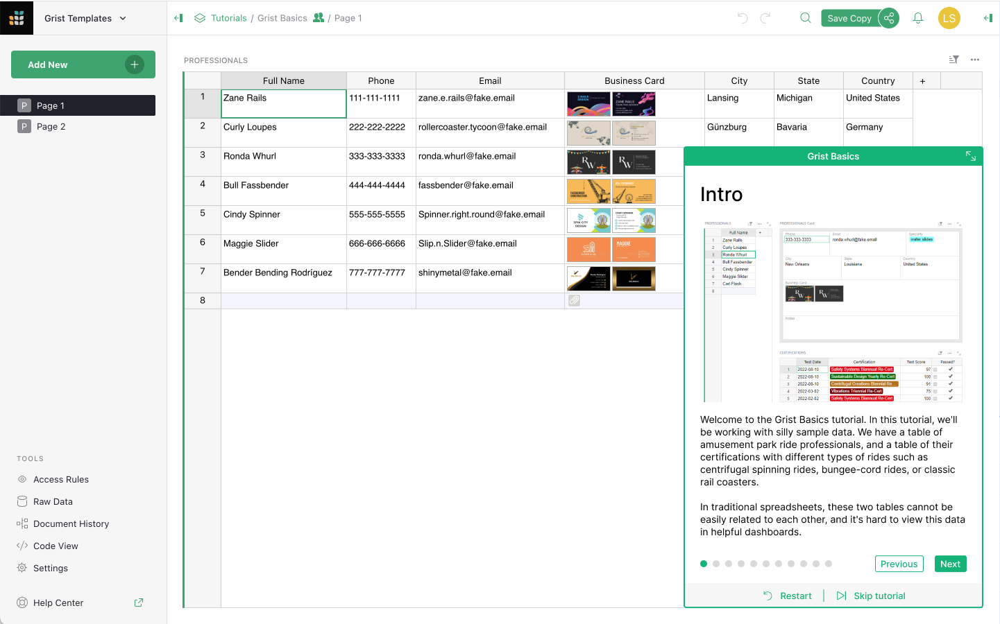

# Grist

Self-hosted relational spreadsheet — an Airtable alternative with real database structure. Columns are typed and named like a database, formulas run in Python with the full standard library, records link across tables, and everything (documents, attachments, access rules) lives in SQLite files on your own server. No per-seat billing, no record caps.

*Screenshot from the upstream Grist repository ([gristlabs/grist-core](https://github.com/gristlabs/grist-core), Apache-2.0).*

## Source Repository

[https://github.com/INAPP-Mobile/grist](https://github.com/INAPP-Mobile/grist)

## Deploy and Host

Click **Deploy on Railway** above. Three fields on the deploy form: a generated session secret, a generated boot key, and your email. On first run, open the public URL, paste the generated boot key at `/boot`, and complete Quick setup — pick your admin email, sign-in method, and permission preset. No companion database, no build step.

## Why Deploy

- **Your data, your server.** Documents are portable SQLite files on a Railway volume — export or back them up any time, move them anywhere.
- **Spreadsheets with a database brain.** Typed columns, reference columns, reference lists, and summary tables — the things traditional spreadsheets cannot relate.
- **Python formulas.** Full Python syntax plus Excel functions, sandboxed per document (gVisor by default, WebAssembly via `GRIST_SANDBOX_FLAVOR=pyodide`).
- **Dashboards, not just grids.** Card, chart and calendar widgets you can lay out and link, plus form views for collecting data.
- **Automate it.** A REST API, Zapier actions, outgoing webhooks, and CSV/Excel import and export.
- **Access control.** Share individual documents, workspaces or team sites, and control access down to rows, columns and tables (needs an SSO login method for per-user rules).

## Common Use Cases

- Team tracker that outgrew a spreadsheet: projects, inventory, applicants, budgets
- Lightweight internal database with a friendly grid UI instead of raw SQL
- Data collection via form views, with the results landing in a structured table
- Personal database for collections, research notes, or household admin
- Backend for small tools and automations via the REST API

## Configuration

| Variable | Default | What it does |
|---|---|---|
| `GRIST_SESSION_SECRET` | `${{secret(64)}}` (deploy form) | Long random string that signs login sessions. Never change after first boot. |
| `GRIST_BOOT_KEY` | `${{secret(32)}}` (deploy form) | Admin boot key — paste it at `/boot` on first run to sign in as install admin and complete Quick setup. |
| `GRIST_DEFAULT_EMAIL` | `you@example.com` (deploy form — replace with your email) | Email that claims the admin account on first login (sign in with getgrist.com). |
| `APP_HOME_URL` | `https://$RAILWAY_PUBLIC_DOMAIN` (derived on boot) | Public base URL for links, forms and embeds. |
| `GRIST_SANDBOX_FLAVOR` | upstream default (`gvisor`) | Formula sandbox: `gvisor`, `pyodide` (WebAssembly), or `unsandboxed`. |
| `GRIST_SINGLE_ORG` | unset | Pin the client to a single org ("domain"). |
| `GRIST_FORCE_LOGIN` | unset (`false`) | Set `true` to require sign-in — only once a sign-in method is configured. |

Upstream self-managed docs: https://support.getgrist.com/self-managed/

### Deployment Dependencies

- **Runtime:** Node 22 + Python formula sandbox, single service
- **Plan:** Hobby or above; ~700 MB RAM at rest (Java-free, but the Node server plus sandbox is heavier than a static site)
- **Port:** Railway-injected `PORT` (Grist reads `$PORT` natively)
- **Persistence:** one Railway volume at `/persist` (documents in `/persist/docs`, users/orgs/settings in `/persist/home.sqlite3`)
- **Healthcheck:** `/boot` (boot-key sign-in page, unauthenticated)
