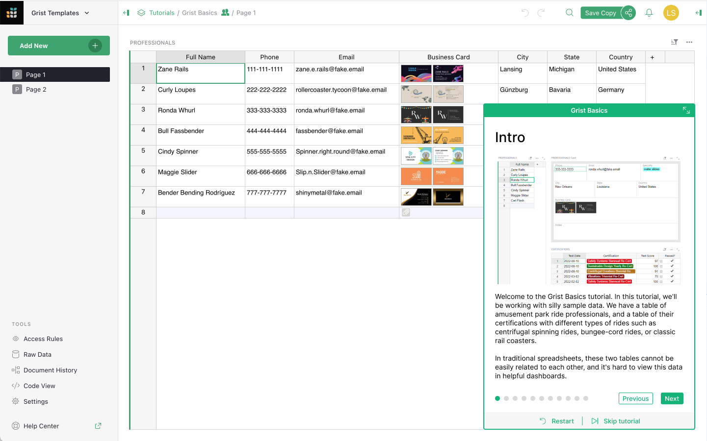

# Deploy and Host

Grist is a self-hosted relational spreadsheet — an Airtable alternative that pairs a familiar grid with the structure of a real database. Deploy it on Railway in one click: documents live as portable SQLite files on a persistent volume, formulas run in Python, and the REST API works out of the box.

## About Hosting

Grist runs as a single service on Railway.

- **What gets deployed:** one Grist service (Node 22 + Python formula sandbox) on the pinned `gristlabs/grist` 1.7.22 image.
- **Database:** embedded SQLite — documents in `/persist/docs`, users and settings in `/persist/home.sqlite3`. No companion database service needed.
- **Persistence:** one Railway volume at `/persist`, so documents, users and settings survive redeploys.
- **First run:** paste the generated boot key at `/boot` and complete Quick setup (admin email, sign-in method, permission preset). The boot key is on the deploy form — no log-diving required.

## Why Deploy

Your data lives on your own server instead of a per-seat SaaS spreadsheet. Columns are typed and named like a database, records link across tables, and Python formulas update automatically. Build card, chart and calendar dashboards, collect data with form views, and automate everything through the REST API, Zapier, or webhooks. Documents are plain SQLite files you can export, back up, and move anywhere.

## Common Use Cases

- Team tracker that outgrew a spreadsheet: projects, inventory, applicants, budgets
- Lightweight internal database with a friendly grid UI instead of raw SQL
- Data collection via form views, with results landing in a structured table
- Personal database for collections, research notes, or household admin
- Backend for small tools and automations via the REST API

## Dependencies for Grist

| Setting | Value |
|---|---|
| Runtime | Node 22 + Python sandbox, single service |
| Plan | Hobby or above |
| Port | Railway-injected `PORT` (Grist reads `$PORT` natively) |
| Persistence | One volume at `/persist` |
| Healthcheck | `/boot` (boot-key sign-in page, unauthenticated) |
| Deploy form | Two generated secrets + your email |

### Deployment Dependencies

- **Upstream:** [gristlabs/grist-core](https://github.com/gristlabs/grist-core) v1.7.22, Apache-2.0, pinned by digest
- **Admin account:** claimed on first login with `GRIST_DEFAULT_EMAIL`; the generated `GRIST_BOOT_KEY` signs you in as install admin at `/boot` to complete Quick setup
- **Session secret:** generated `GRIST_SESSION_SECRET` on the deploy form; never change it after first boot or everyone gets signed out
- **Base URL:** derived on every boot from the live Railway public domain
- **Formula sandbox:** gVisor by default; switch to `GRIST_SANDBOX_FLAVOR=pyodide` if the gVisor check fails at boot
- **Sign-in methods:** no authentication, sign in with getgrist.com, forwarded headers, or OIDC — picked in Quick setup; set `GRIST_FORCE_LOGIN=true` only once a method is configured
